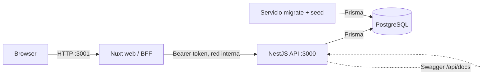

# HelpDesk Lite

Sistema multiempresa de tickets de soporte para dos o más organizaciones. El monorepo contiene una API REST con NestJS, una interfaz Nuxt y persistencia PostgreSQL administrada por Prisma.

## Stack

| Capa | Tecnología |
|---|---|
| Frontend | Nuxt 3, Vue, TypeScript, Pinia |
| API | NestJS, TypeScript, Swagger/OpenAPI |
| Persistencia | PostgreSQL 16, Prisma 7 y migraciones versionadas |
| Sesión | JWT de acceso y refresh token rotativo; cookies `httpOnly` a través del BFF de Nuxt |
| Pruebas | Vitest, Supertest y Playwright |
| Contenedores | Docker Compose; imágenes base fijadas por digest |

## Arquitectura



El navegador solo usa el origen de Nuxt. El BFF guarda los tokens en cookies `httpOnly` y añade el Bearer al llamar a la API. PostgreSQL solo está en la red interna de Compose por defecto.

## Requisitos

- Docker con Docker Compose v2.
- `make` para ejecutar el conjunto de pruebas con `make test`.

## Arranque con Docker

Desde la raíz del repositorio:

```bash
docker compose up --build
```

No se requiere crear `.env` para desarrollo local: Compose tiene valores locales de respaldo. Al primer arranque espera a que PostgreSQL esté healthy, ejecuta migraciones y seed, y luego inicia la API y la web.

- Web: <http://localhost:3001>
- API: <http://localhost:3000/api>
- Swagger: <http://localhost:3000/api/docs>

Para correr en segundo plano usa `docker compose up --build -d`; para detener los servicios sin borrar los datos de la base:

```bash
docker compose down
```

### Exponer PostgreSQL al host

PostgreSQL no publica su puerto en la configuración normal. Si necesitas conectarte desde una herramienta instalada en el host, activa el override de desarrollo:

```bash
docker compose -f docker-compose.yml -f docker-compose.dev.yml up --build
```

Por defecto publica el puerto `5432` del host; se puede cambiar con `POSTGRES_PORT`.

### Variables de entorno

Los valores predeterminados de Compose son solo para desarrollo local. Antes de desplegar, crea un `.env` desde `.env.example` y configura credenciales únicas, un `JWT_SECRET` aleatorio y `FRONTEND_ORIGIN` con el origen real del frontend. En HTTPS, configura el proxy y las cookies para producción. `.env` está excluido de Git.

## Cuentas de prueba

El seed crea las organizaciones `acme` y `globex`, con una cuenta de cada rol por organización. La contraseña de las cuentas de prueba es `Test1234!`.

| Organización | Admin | Agente | Cliente |
|---|---|---|---|
| `acme` | `admin@acme.com` | `agente@acme.com` | `cliente@acme.com` |
| `globex` | `admin@globex.com` | `agente@globex.com` | `cliente@globex.com` |

El formulario de login pide el slug de la organización, correo y contraseña. Estas credenciales son solo para desarrollo y pruebas.

## Funcionalidad

- Aislamiento de tickets por organización; CUSTOMER solo ve sus tickets.
- Creación de tickets por CUSTOMER; asignación, cambios de estado y comentarios según permisos.
- Estados `OPEN`, `IN_PROGRESS`, `RESOLVED` y `CLOSED`, con reapertura de `RESOLVED` a `IN_PROGRESS`.
- Cálculo de SLA en horario hábil de Bogotá, con festivos guardados en la base de datos.
- Historial de auditoría de asignaciones y cambios de estado.
- Reporte de SLA por agente para ADMIN, calculado en SQL para los últimos 30 días.
- Filtros y paginación de tickets desde el servidor, detalle, comentarios e indicador de SLA.

## Pruebas

Con Docker disponible, desde la raíz:

```bash
make test
```

El comando levanta el stack y corre pruebas unitarias y e2e del API, pruebas de componente Vitest y el flujo Playwright en contenedores. La prueba Playwright inicia sesión, crea un ticket y comprueba que aparece en el listado.

## Desarrollo local

Para ejecutar API o web fuera de Compose, crea el archivo raíz `.env` usando `.env.example`. Inicia PostgreSQL con el override de desarrollo:

```bash
docker compose -f docker-compose.yml -f docker-compose.dev.yml up -d db
```

Luego, en terminales separadas:

```bash
cd api
npm ci
npx prisma generate
npx prisma migrate deploy
npm run db:seed
npm run start:dev
```

```bash
cd web
npm ci
npm run dev -- --port 3001
```

## Estructura del repositorio

```text
api/                  API NestJS, Prisma, migraciones y pruebas
web/                  Aplicación Nuxt, BFF, páginas y pruebas
seed/tickets.json     Tickets de ejemplo definidos en el enunciado
docker-compose.yml    Stack local, migraciones y seed
docker-compose.dev.yml Publicación opcional del puerto de PostgreSQL
Makefile              Ejecución de pruebas en contenedores
```

## Decisiones y seguridad

- [DECISIONES.md](./DECISIONES.md): elecciones técnicas y discrepancias del enunciado.
- [SEGURIDAD.md](./SEGURIDAD.md): revisión de los tres ejemplos heredados, controles actuales y límites conocidos.
- [USO_IA.md](./USO_IA.md): declaración del uso de asistentes de IA.
